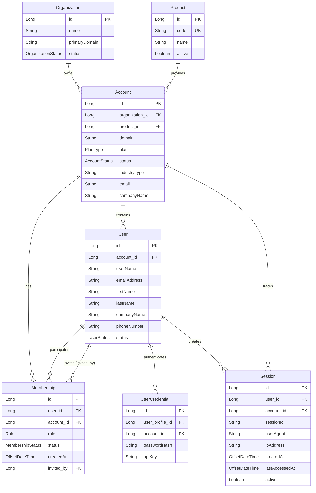
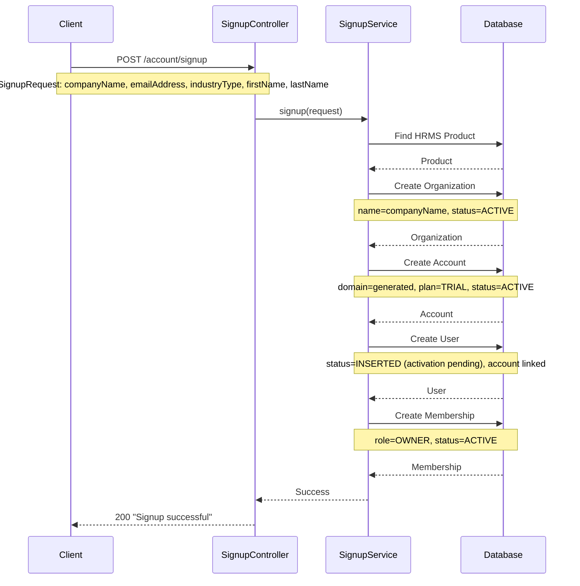
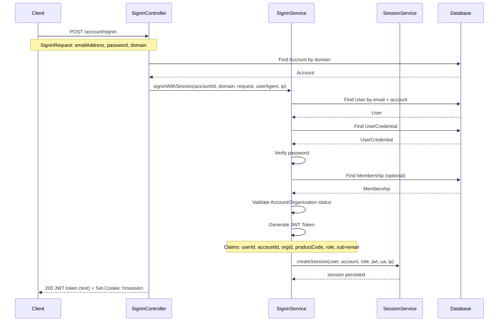
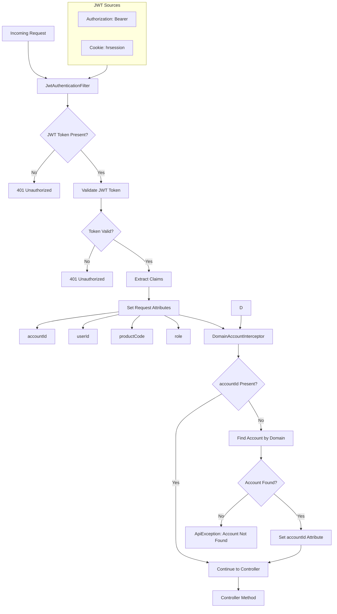
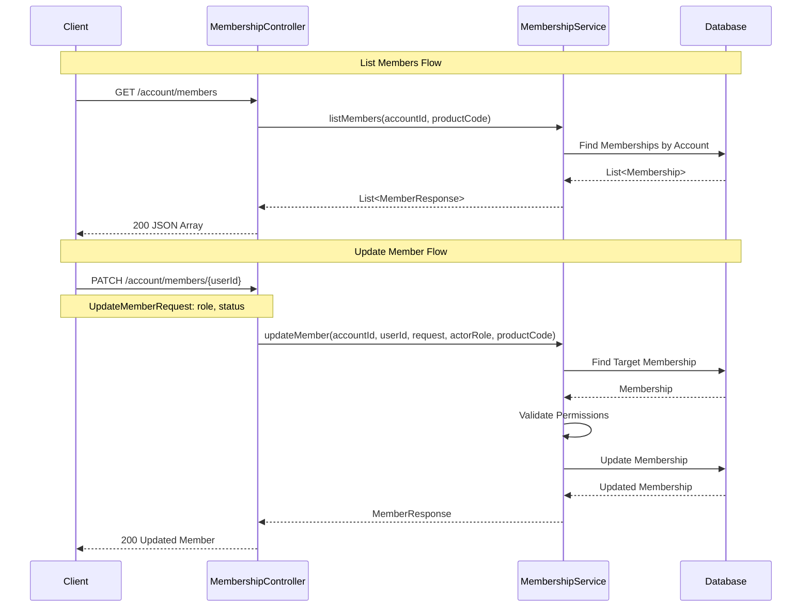
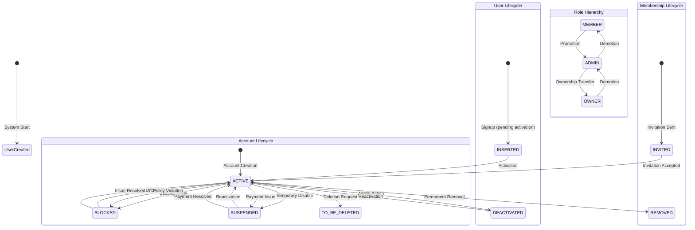

# Delight Account Service - Application Flow Diagram

This document contains comprehensive flow diagrams for the Delight Account Service application.

## Entity Relationship Diagram



## Application Flow Overview

```mermaid
flowchart TD
    A[Client Request] --> B{Authentication Required?}
    B -->|No| C[Public Endpoints]
    B -->|Yes| D[JWT Authentication Filter]
    
    C --> C1[/account/signup]
    C --> C2[/account/signin]
    C --> C3[/account/activate]
    
    D --> E[Domain Account Interceptor]
    E --> F{Account Found by Host domain?}
    F -->|No| G[ApiException: Account Not Found]
    F -->|Yes| H[Set Account Context]
    
    H --> I[Protected Endpoints]
    I --> I1[/account/info]
    I --> I2[/account/members]
    I --> I3[/accounts/session]
    I --> I4[/accounts/logout]
    I --> I5[/accounts/logout-all]
    
    C1 --> J[SignupService]
    C2 --> K[SigninService]
    C3 --> L[ActivationService]
    
    I1 --> M[AccountService]
    I2 --> N[MembershipService]
    I3 --> O[SessionService]
    I4 --> O
    I5 --> O
    
    J --> P[(Database)]
    K --> P
    L --> P
    M --> P
    N --> P
    O --> P

    subgraph Note[Host-based Routing]
      note1[All endpoints except /account/signup use HTTP Host header as company domain. For local dev, send Host: companyDomain while targeting localhost.]
    end

    subgraph ApiAlias[/api Alias Behavior]
      api1[/api/... endpoints mirror regular paths except signup/signin/activation\nBearer-only for protected endpoints (cookies not accepted)\nGlobal rate limits apply (on non-/api global endpoints)/]
    end
    ApiAlias -. applies to .-> I
```

## Signup Flow



## Signin + Session Flow



## Authentication & Authorization Flow



## Membership Management Flow



## Status and Role Transitions



## Data Flow Architecture

```mermaid
flowchart LR
    subgraph "Presentation Layer"
        A[REST Controllers]
        A1[SignupController]
        A2[SigninController]
        A3[MembershipController]
        A4[AccountInfoController]
        A5[ActivationController]
        A6[SessionController]
        A0[BaseApiController\n(dual routing helper)]
    end
    
    subgraph "Security Layer"
        B[JwtAuthenticationFilter]
        C[DomainAccountInterceptor]
    end
    
    subgraph "Service Layer"
        D[SignupService]
        E[SigninService]
        F[MembershipService]
        G[AccountService]
        H[ActivationService]
        I[SessionService]
    end
    
    subgraph "Data Access Layer"
        J[Repositories]
        J1[AccountRepository]
        J2[UserRepository]
        J3[MembershipRepository]
        J4[OrganizationRepository]
        J5[ProductRepository]
        J6[UserCredentialRepository]
        J7[SessionRepository]
    end
    
    subgraph "Caching"
        L1[CacheService]
        L2[RedisCacheServiceImpl]
        L3[CacheKeyManager\nVersionedCacheKeyManager]
    end
    
    subgraph "Datastores"
        K[(TiDB/MySQL)]
        R[(Redis)]
    end
    
    A --> B
    B --> C
    C --> A1
    C --> A2
    C --> A3
    C --> A4
    C --> A5
    C --> A6
    
    %% Dual routing helper
    A0 -. extends .-> A3
    A0 -. extends .-> A4
    A0 -. extends .-> A6
    
    A1 --> D
    A2 --> E
    A3 --> F
    A4 --> G
    A5 --> H
    A6 --> I
    
    D --> J1
    D --> J2
    D --> J3
    D --> J4
    D --> J5
    D --> L1
    
    E --> J1
    E --> J2
    E --> J3
    E --> J6
    E --> L1
    
    F --> J1
    F --> J3
    F --> L1
    
    G --> J1
    G --> J3
    G --> L1
    
    H --> J1
    H --> J2
    H --> J3
    H --> J6
    H --> L1
    
    I --> J7
    
    J --> K
    L1 --> L2
    L1 --> L3
    L2 --> R
```

## Enum Values Reference

### UserStatus
- `ACTIVE`: User is active and can sign in
- `DEACTIVATED`: User is temporarily deactivated
- `BLOCKED`: User is blocked due to security issues
- `INSERTED`: User record inserted (data migration status)

### MembershipStatus
- `INVITED`: User has been invited but not yet accepted
- `ACTIVE`: User is an active member of the account
- `SUSPENDED`: User membership is temporarily suspended
- `REMOVED`: User has been removed from the account

### AccountStatus
- `ACTIVE`: Account is active and operational
- `SUSPENDED`: Account is suspended (e.g., payment issues)
- `BLOCKED`: Account is blocked due to policy violations
- `TO_BE_DELETED`: Account is marked for deletion

### Role
- `OWNER`: Full administrative privileges
- `ADMIN`: Administrative privileges (limited)
- `MEMBER`: Basic user privileges (displayed as "USER" in API responses)

### PlanType
- `TRIAL`: Trial account
- `PAID`: Paid subscription account

### OrganizationStatus
- `ACTIVE`: Organization is active
- `SUSPENDED`: Organization is suspended
- `DELETED`: Organization is deleted
