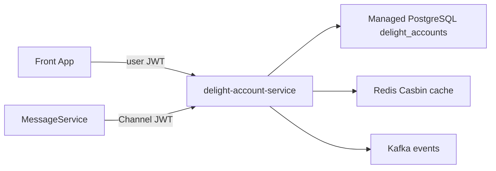

# IAM Service Changes Plan (`delight-account-service`)

| Field | Value |
|-------|-------|
| Repo | [`delight-account-service`](../delight-account-service) |
| DB target | **Managed PostgreSQL** (`delight_accounts`) — replace TiDB |
| Related HLD | [`docs/HLD-STP-WTP-IAM-CHANGES.md`](../delight-account-service/docs/HLD-STP-WTP-IAM-CHANGES.md) |
| Sibling plan | [Message Service Development](message-service-development.plan.md) |

## Goals

1. Replace **TiDB/MySQL with PostgreSQL** (local + managed prod).
2. Become the STP/WTP **identity and tenancy authority** (org → account → site scope → users/roles).
3. Harden security (no public test mutation, cookies, secrets, audit).
4. Expose trustworthy Channel APIs for MessageService (`session`, `authorize/check`).
5. Never store gateways, measurements, or device private keys.

## Non-goals

- Device registry, MQTT ingest, Timescale, UV500 profiles → **MessageService**
- Customer Front App UI (beyond cleaning RAG from account SPA)
- PCB adapter, alerts product
- Department / Group hierarchy

## Architecture (IAM only)

```text
Browser / Front App
  → user JWT / hrsession
  → TenantFilter + JwtAuthenticationFilter
  → Casbin + site-scope check
  → Account / Site / Membership / Audit APIs

MessageService / other backends
  → Channel JWT + /channel/**
  → ChannelAuthFilter
  → session validate | authorize/check
  → Kafka events (site.*, membership.*)
```

**DB:** Managed PostgreSQL database `delight_accounts` (separate from MessageService `delight_telemetry`).



---

## Workstream 0 — PostgreSQL migration (replace TiDB)

### Why

Platform standard: managed PostgreSQL for all services. TiDB-specific SQL (`AUTO_RANDOM`, `@@tidb_*`, MySQL dialect) must go.

### Scope

| Area | Change |
|------|--------|
| `compose.yaml` | Replace `tidb` with `postgres:16` (port **5432**); keep Redis/Kafka |
| `build.gradle` | `mysql-connector-j` → `org.postgresql:postgresql` |
| JDBC | `jdbc:postgresql://127.0.0.1:5432/delight_accounts` |
| Liquibase | `liquibase.database.typeName=postgresql`; rewrite changelogs |
| JPA | PostgreSQLDialect; IDENTITY/sequences instead of AUTO_RANDOM |
| Tests | H2 `MODE=MySQL` → Postgres Testcontainers or H2 PostgreSQL mode |
| Env / README | Update `DB_URL`, remove TiDB port 4000 docs |

### Liquibase migration approach (recommended)

1. **Baseline for Postgres:** New changelog set (or `db.changelog-master-pg.yaml`) using Liquibase cross-DB types (`bigint`, `varchar`, `timestamptz`, `boolean`, `jsonb` where needed).
2. Replace TiDB `AUTO_RANDOM` with `BIGSERIAL` / `GENERATED BY DEFAULT AS IDENTITY`.
3. Drop `SET @@tidb_allow_remove_auto_inc` and TiDB partition DDL (use normal indexes; optional PG partitioning later).
4. Add real FKs where safe (Postgres supports them; TiDB intentionally skipped FKs).
5. Keep Redis + Kafka unchanged.

### Acceptance (IAM-PG1)

- `podman compose up` starts Postgres; `./gradlew bootRun` migrates cleanly
- Signup → activate → signin → session → channel authorize smoke test green
- CI uses Postgres (Testcontainers preferred)
- No TiDB image or mysql JDBC in default local path

---

## Workstream 1 — P0 hardening

| ID | Change | Done when |
|----|--------|-----------|
| IAM-A1 | Delete `TestAccountUpdateController`; remove `/test/**` permitAll | No anonymous account mutation |
| IAM-A2 | Cookie `Secure` + `SameSite` env-dependent | Prod Secure=true |
| IAM-A3 | Placeholders only in tracked `envVariables_*` | Secrets via deploy/env |
| IAM-A4 | Remove RAG screens/routes from frontend | Build green |

---

## Workstream 2 — Sites & site-scoped membership (P1)

### Domain

```text
Organization → Account
  ├── Site (code = MQTT {siteId})
  ├── Membership → Role → Privileges
  │     └── MembershipSiteScope: ALL_SITES | SELECTED + membership_sites
  └── Session
```

### Tables

- `sites`: id, account_id, code, name, status, timezone, metadata, timestamps
- `membership_site_scopes`: membership_id, scope_type
- `membership_sites`: membership_id, site_id

### AuthZ (Option A — pilot)

1. Casbin privilege check  
2. If resource has `siteId` → require ALL_SITES or site in selected set  

### APIs / events

- CRUD `/accounts/sites`
- `PUT /accounts/members/{id}/site-scope`
- Events: `site.created.v1`, `site.updated.v1`, `site.deactivated.v1`
- Session + authorize responses include `siteScope`

### Stories

IAM-B1…B5 (create/deactivate site, set scope, operator deny out-of-scope, MessageService consumes events)

---

## Workstream 3 — Privileges & authorize fix (P1)

| ID | Work |
|----|------|
| IAM-C1 | Seed monitoring privileges (`site.*`, `device.*`, `measurement.*`, `alert.*`, `pcb.*`, `audit.read`) |
| IAM-C2 | **Fix** `AuthorizationServiceImpl` channel always-true — real Casbin enforce |
| IAM-C3 | `authorize/check` accepts optional `siteId` |
| IAM-C4 | Session payload includes siteScope |

**Critical:** MessageService must not rely on privilege gates until IAM-C2 ships.

---

## Workstream 4 — Service identities & audit (P2)

| ID | Work |
|----|------|
| IAM-D1 | `service_identities` + issue/rotate (fingerprint only) |
| IAM-D2 | Dual-run Channel HMAC + service credentials; deprecate HMAC later |
| IAM-D3 | Append-only `security_audit_events` |
| IAM-D4 | Failed sign-in lockout |
| IAM-E1–E3 | Invitation expiry/resend, password reset, optional MFA (admins) |

---

## Delivery phases (IAM)

| Phase | Weeks | Focus | Exit |
|-------|-------|-------|------|
| **P0** | 1–3 | Postgres migration + hardening | App on Postgres; no public test mutation |
| **P1** | 3–6 | Sites, privileges, authorize fix | Site-scoped deny; MessageService can trust authorize/check |
| **P2** | 6–9 | Audit, service identity, lockout, invite/reset | Audit queryable; staging on managed PG |

## Suggested ticket order

1. IAM-PG1 — TiDB → PostgreSQL  
2. IAM-A1 — Remove test mutation  
3. IAM-A2 — Cookies  
4. IAM-C2 — Fix authorize/check  
5. IAM-C1 — Seed privileges  
6. IAM-B1 — Sites CRUD  
7. IAM-B3 — Membership site scope  
8. IAM-C3/C4 — siteId on authorize + session  
9. IAM-D3 — Security audit  
10. IAM-D1 — ServiceIdentity  

## Risks

| Risk | Mitigation |
|------|------------|
| Liquibase MySQL-only history on existing envs | Fresh PG baseline for new STP/WTP; or one-shot dump/transform |
| AUTO_RANDOM ID consumers | Keep BIGINT; document new ID generation |
| Channel always-true | Block MessageService privilege gates until fixed |

## Out of scope (see Message Service plan)

Gateway/analyser registry, MQTT/HTTPS ingest, Timescale, UV500 decode, measurement query APIs.
