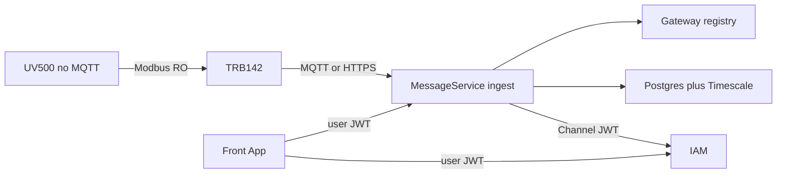

# Message Service Development Plan

| Field | Value |
|-------|-------|
| Repo today | [`delight-telemetry-poc`](../delight-telemetry-poc) |
| Target name | `delight-message-service` (rename when ready) |
| DB target | **Managed PostgreSQL** + Timescale (`delight_telemetry`) |
| Sibling plan | [IAM Service Changes](iam-service-changes.plan.md) |
| Depends on IAM | Channel session; authorize/check + site events (after IAM P1) |

## Goals

1. Own **IoT edge path**: register TRB142, map UV500, ingest MQTT and/or HTTPS, store timeseries.
2. **Authenticate and authorize every payload** (gateway identity ≠ human JWT).
3. Run on **managed PostgreSQL + Timescale** in production (Podman Timescale for local only).
4. Expose stable **query/registry APIs** for the Customer Front App.
5. Never own human identity — always call IAM `/channel/**`.

## Non-goals

- IAM sites as authz SoT implementation (IAM plan) — MessageService only **projects** `accountId` + `siteCode`
- Front App UI screens
- PCB adapter, full alerts, Modbus writes
- Department / Group hierarchy
- Self-hosting production Mosquitto/Postgres

## Architecture

```text
UV500 --RS-232 Modbus RO--> TRB142 --MQTT mTLS or HTTPS--> MessageService
                                                      │
                         IAM ◄── Channel JWT ─────────┤
                                                      ▼
                                         Managed PostgreSQL + Timescale
                                         (delight_telemetry)
```



### Ownership

| Owns | Does not own |
|------|----------------|
| Site **projection**, gateway, analyser, map, credential fingerprints | IAM users/roles/sessions |
| MQTT/HTTPS ingest, decode, raw + measurements | Device private keys at rest |
| Query APIs (`/v1/measurements`, rollups, ingest-events) | PCB / alerts (later) |

**Site rule:** MQTT `{siteId}` = IAM `sites.code`. Until IAM sites ship, POC may create provisional codes in MessageService.

---

## Current POC baseline (done)

Already in `delight-telemetry-poc`:

- Podman Timescale + Mosquitto mTLS
- Registry APIs: site, analyser, gateway, issue cert (once), map, revoke
- Per-message ingest checks + UV500 profile decode
- IAM session filter on HTTP APIs
- `trb142-sim.py`

---

## Workstream A — POC harden & productize

| ID | Work | Done when |
|----|------|-----------|
| MSG-F1–F6 | Keep registry stories; document OpenAPI `/v1` | Spec checked in |
| — | E2E script: register → issue → map → sim → query | Script in `scripts/` |
| — | Optional package rename `com.delight.message` | Decision + PR |
| MSG-H5 | Confirm device cert cannot call query APIs | Test |

---

## Workstream B — IAM coupling (after IAM P1)

| ID | Work |
|----|------|
| MSG-F7 / B5 | Consume `site.*.v1` or validate site via IAM before gateway create |
| — | Call `authorize/check` for `device.provision`, `measurement.read`, etc. |
| MSG-H2 | Enforce SELECTED site scope on measurement queries |

**Blocker:** Do not enable hard privilege deny until **IAM-C2** (authorize always-true fixed).

---

## Workstream C — Ingest (MQTT + HTTPS)

### Shared pipeline

```text
Transport adapter → IngestEnvelope
  → principal == gatewayId
  → gateway ACTIVE + credential
  → site/account match + IAM account active
  → payload identity match (if present)
  → map + profileVersion
  → idempotent messageId
  → telemetry_raw → decode → measurements
  → ingest_events
```

Reject codes: `UNAUTHENTICATED`, `UNAUTHORIZED_TOPIC`, `UNKNOWN_GATEWAY`, `REVOKED`, `UNMAPPED`, `PAYLOAD_IDENTITY_MISMATCH`, `DUPLICATE`, `OK`

| ID | Work |
|----|------|
| MSG-G1–G6 | MQTT path (mostly done) — automate remaining e2e negatives |
| MSG-G7 | `POST /v1/ingest/https` — mTLS or device token; same pipeline |

Topic (MQTT):  
`v1/tenants/{accountId}/sites/{siteCode}/gateways/{gatewayCode}/telemetry`

---

## Workstream D — Storage & managed Postgres

| Item | Dev | Prod |
|------|-----|------|
| Engine | Podman `timescale/timescaledb` | Managed PostgreSQL + Timescale extension |
| Database | `telemetry` / `delight_telemetry` | `delight_telemetry` |
| Tables | sites, gateways, credentials, analysers, maps, raw, measurements, dedup, events | same |
| Aggregates | `measurements_1min`, `measurements_1hour` | same |

| ID | Work |
|----|------|
| MSG-I1 | `prod` profile → managed JDBC URL; health check |
| MSG-I4 | Optional raw archive to S3-compatible object storage |

**Note:** IAM uses a **different** Postgres database (`delight_accounts`). Never share schemas.

---

## Workstream E — Cloud MQTT / API freeze

| ID | Work |
|----|------|
| — | ADR: E2E vs AWS vs Azure (credits + managed MQTT) |
| MSG-I2 | AWS IoT Core or Azure IoT Hub adapter **or** HTTPS-only if no MQTT |
| MSG-I3 | Keep local Mosquitto profile for dev |
| — | Freeze OpenAPI for Front App (registry + measurements) |
| — | Light load test (1 site, 1-min polling) |

---

## Delivery phases (MessageService)

| Phase | Weeks | Focus | Exit | IAM dependency |
|-------|-------|-------|------|----------------|
| **P0** | 1–2 | Harden POC, OpenAPI, e2e | Demo reliable | Session only |
| **P1** | 3–5 | Site sync + privilege gates | Deny cross-site query | Needs IAM sites + C2 |
| **P2** | 5–8 | HTTPS ingest + managed PG | Prod-shaped DB + HTTPS | Managed PG both sides |
| **P3** | 8–10 | Cloud IoT / HTTPS-only ADR | Frozen APIs for Front App | — |

## Suggested ticket order

1. OpenAPI + e2e register/publish script  
2. Automate negative ingest tests (G2–G5)  
3. MSG-G7 HTTPS ingest  
4. MSG-I1 Managed Postgres profile  
5. Site sync from IAM (after IAM-B1)  
6. Privilege gates on registry (after IAM-C2)  
7. Site-scoped measurement filter (H2)  
8. Cloud ADR + IoT adapter or HTTPS-only  
9. OpenAPI freeze for Front App  
10. Optional object archive (I4)  

## Risks

| Risk | Mitigation |
|------|------------|
| IAM authorize still always-true | Soft-fail or feature-flag privilege gates until IAM-C2 |
| Dual site stores | Single `code`; IAM SoT after P1 |
| No managed MQTT on E2E | HTTPS ingest primary |

## Out of scope (see IAM plan)

TiDB→Postgres IAM migration, sites authz tables, Casbin privileges, service identities, human audit log.
